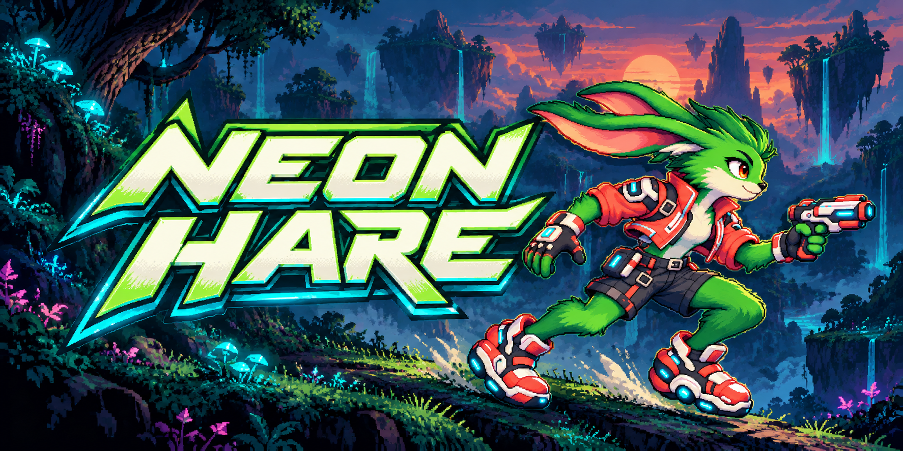
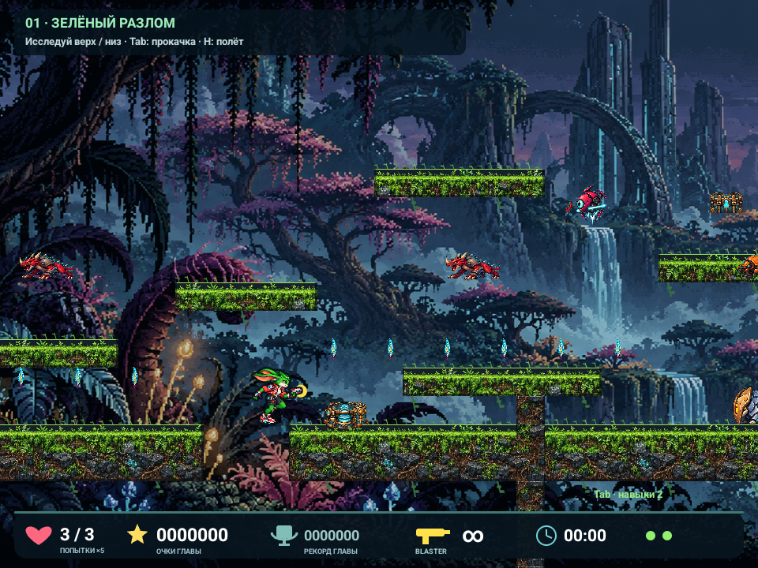
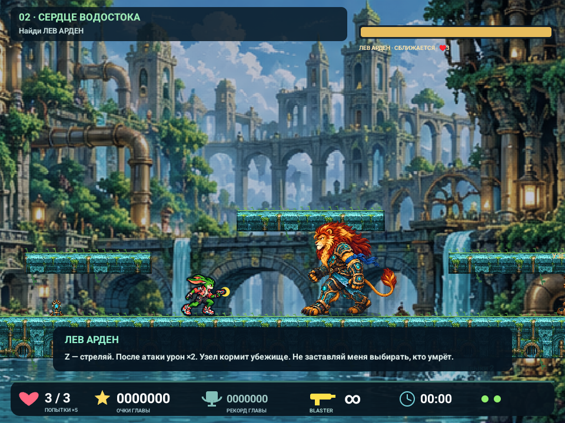
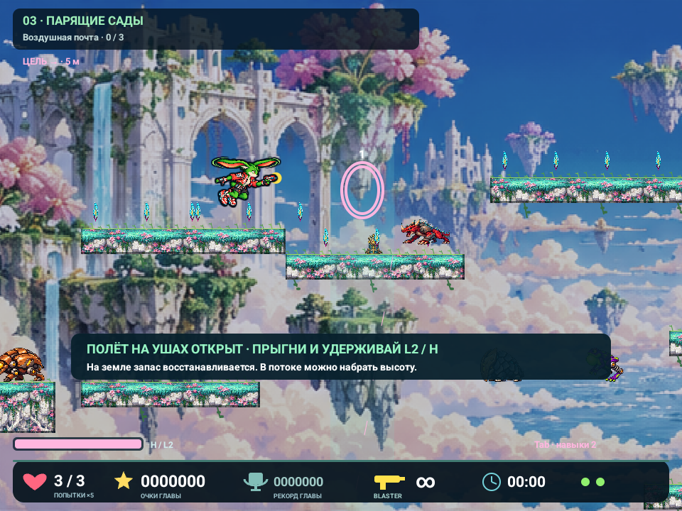

[English](README.md) · [Русский](README.ru.md)



# Neon Hare

**Run fast. Find the hidden route. Turn a former enemy into an ally.**

Meet **Stu**, a green rabbit with a blaster and a pair of ears that can do more than listen. Neon Hare is a colourful 2D action platformer for Android phones and handhelds: double jumps, secret weapon caches, underground detours, airborne gardens and bosses with something to lose.

[**APK downloads / Releases**](https://github.com/sklevtsov/neonhare/releases) · [Report a bug](https://github.com/sklevtsov/neonhare/issues/new/choose) · [Development plan](docs/development-plan.md)

> **In development.** The campaign contains 12 playable prototype chapters; pacing, tutorials and balance are still being refined. The game currently uses **Russian** text. An English game version is planned. Public signed APK distribution requires the one-time release-key setup described below; until the first release is published, Releases may be empty.

## A rabbit, a broken world and a second chance

Explore forests, waterworks, floating islands, neon streets, crystal caves, desert ruins and an icy citadel. Collect energy seeds, improve Stu's abilities and discover the story tucked away in hidden archives. Face **Lev Arden**, a powerful lion whose choices have hurt the people he meant to protect. Defeating him opens a path to reconciliation — and unlocks Stu's helicopter ears.

- **Movement with room to learn:** variable-height jumps, a double jump, coyote time, springs, air currents and ear-powered flight.
- **Five weapons:** unlimited blaster, pulse fire, scatter shots, frost and ricochets. Find concealed caches and invest in five skill branches.
- **Routes worth exploring:** upper and lower paths, passages, cracked walls, chapter objectives, secrets and Easter eggs.
- **Progress that stays with you:** checkpoint saves, unlocked chapter selection, chapter scores, fastest times and secret records.
- **Play your way:** Anbernic buttons, a connected controller or phone touch controls. Landscape layout adapts from 4:3 handheld screens to wide phones.
- **Offline:** no accounts, ads or requested Internet permission in the current app.

## Screenshots

Actual emulator captures of staged scenes from the current game renderer, with developer annotations hidden. The banner above is promotional artwork. UI and balance are work in progress.

| The green rift | Lev Arden |
|---|---|
|  |  |



[Capture details and artwork provenance](docs/media/README.md)

## Get the game

1. Open [Releases](https://github.com/sklevtsov/neonhare/releases) and choose the latest published release. Pre-releases are testing builds.
2. Under **Assets**, download `neon-hare-<version>.apk`. GitHub's “Source code” archives contain source, not the installable game.
3. Open the APK on Android and allow installation from that browser/file manager if prompted. Android **6.0+** is the code's minimum; device coverage is still limited.
4. Install future official releases over the existing app to keep progress. Do not uninstall or clear app data to update.

Release assets include `SHA256SUMS`. See [release signing and installation](docs/releases.md) for verification, development builds and the one-time key setup. APKs are distributed through Releases, not stored in Git. Development APK artifacts from [Actions](https://github.com/sklevtsov/neonhare/actions/workflows/ci.yml) use the separate `com.neonhare.game.debug` application and are intended for developers.

**Compatibility:** the project targets the Anbernic RG406V (960×720) and ordinary Samsung/Android landscape screens, including wide displays and cutouts. Touch controls are available. A successful emulator run does not establish stability on every phone; each stable candidate needs a physical-device check.

## Controls

| Action | Anbernic / controller | Keyboard |
|---|---|---|
| Move | D-pad / left stick | ← → |
| Jump / double jump | Up, A or B | ↑ / Space |
| Fire (hold) | X, R1 or R2 | Z |
| Change weapon | Y / L1 | X |
| Helicopter ears | Hold L2 while airborne | Hold H while airborne |
| Passage / drop through platform | Down | ↓ / E |
| Menu, save and level selection | Start | Esc / M / P / Enter |
| Skills | **Select** | Tab |
| Select / buy a skill | D-pad, then A | 1–5 / ↑↓, then Enter |

Release and press jump again for the second jump. Ears unlock automatically after the Lion encounter in chapter 2: **jump, then hold L2 / H**; land to recharge. On phones, use the on-screen controls. Checkpoints and progress save automatically; the main menu also offers an explicit save-and-exit action.

## Build and develop

Native **Java + Android Canvas/SurfaceView**, with a fixed-step simulation and no third-party runtime game engine. Requires **JDK 17**, **Python 3.10+**, Android SDK platform **35**, build-tools **34.0.0** and platform-tools. The Gradle wrapper downloads the pinned Gradle version.

```sh
git clone https://github.com/sklevtsov/neonhare.git
cd neonhare
# Set ANDROID_HOME to your installed Android SDK, or create local.properties with sdk.dir=...
./gradlew assembleDebug
```

The development APK is `app/build/outputs/apk/debug/app-debug.apk`. On an explicitly chosen emulator:

```sh
adb -s emulator-5554 install -r app/build/outputs/apk/debug/app-debug.apk
adb -s emulator-5554 shell am start -n com.neonhare.game.debug/com.neonhare.game.MainActivity
./scripts/check-game.sh
```

`check-game.sh` targets **only emulator-5554**. Create/start a suitable Android AVD first. The optional `scripts/run-emulator.sh` helper expects an existing AVD named `NeonHare` in the local `.android-dev/avd` directory; it does not provision an SDK/AVD on a fresh checkout.

```sh
./scripts/format-java.sh
python3 tools/level_content.py
./gradlew checkJavaFormat lintDebug lintLocal lintRelease
./scripts/check-signing.sh
./scripts/check-level-extension.sh
```

Gameplay checks run against the actual app on an emulator and cover movement, controller/touch input, weapon origins and collisions, bosses, saves/migration and chapter extension. Debug builds have 99 lives and numeric developer shortcuts; local/release builds disable those features. `./scripts/package-apk.sh --local` is for a developer's existing local signing identity; public builds use `--release` with a dedicated persistent key.

### Add a chapter beside existing ones

```sh
python3 scripts/new-level.py night-postal-hub --title 'Ночной почтовый узел'
python3 tools/level_content.py --preview-dir build/level-previews
```

Design a draft and route map first, then explicitly include the approved chapter in `app/src/main/assets/levels/campaign.json`. Each chapter owns its `level.json` and `design.md`; stable IDs preserve saves when campaign order changes. Add new mechanics through independent objective rules/systems rather than chapter-number branches.

- [Architecture and save contracts](docs/architecture.md)
- [Designing and adding levels](docs/adding-levels.md)
- [Contribution rules](CONTRIBUTING.md) · [Agent instructions](AGENTS.md)
- [Release process](docs/releases.md) · [Security policy](SECURITY.md)
- [Campaign and story](docs/campaign.md) · [Development roadmap, including English localisation](docs/development-plan.md)

Next priorities: polish chapters 1–3, then design the **Night Postal Hub** with delivery routes and interceptors. English localisation is a separate planned milestone. None of these future chapters/features should be mistaken for finished content.

## Licence and artwork

Project source code is available under the [MIT licence](LICENSE), except third-party components with their own terms. **Game art, icons, screenshots and promotional images are excluded from MIT**; no reuse licence is granted for them. See [artwork terms](ASSETS-LICENSE.md) and [third-party notices](THIRD_PARTY_NOTICES.md).
