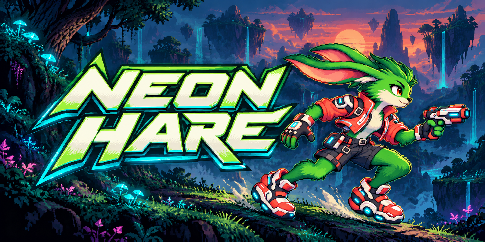
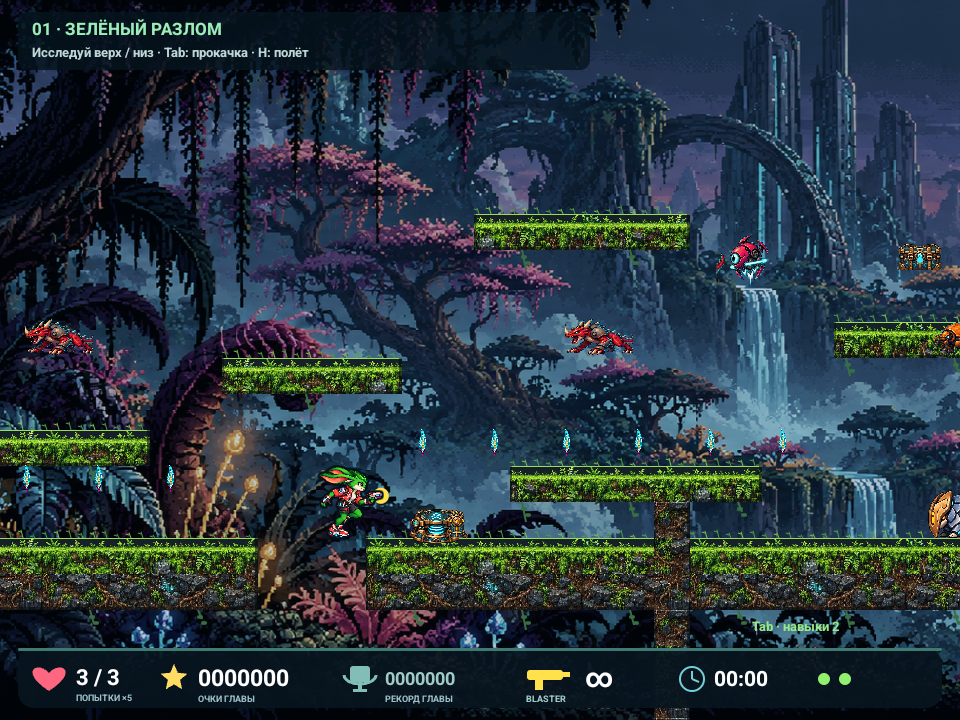
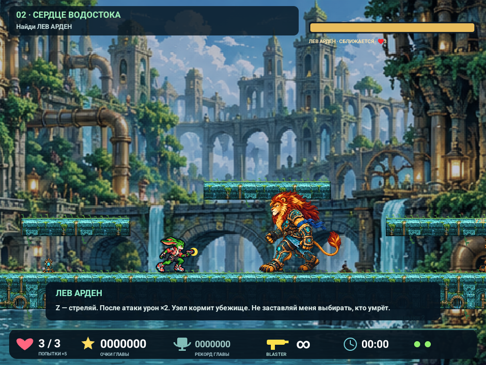
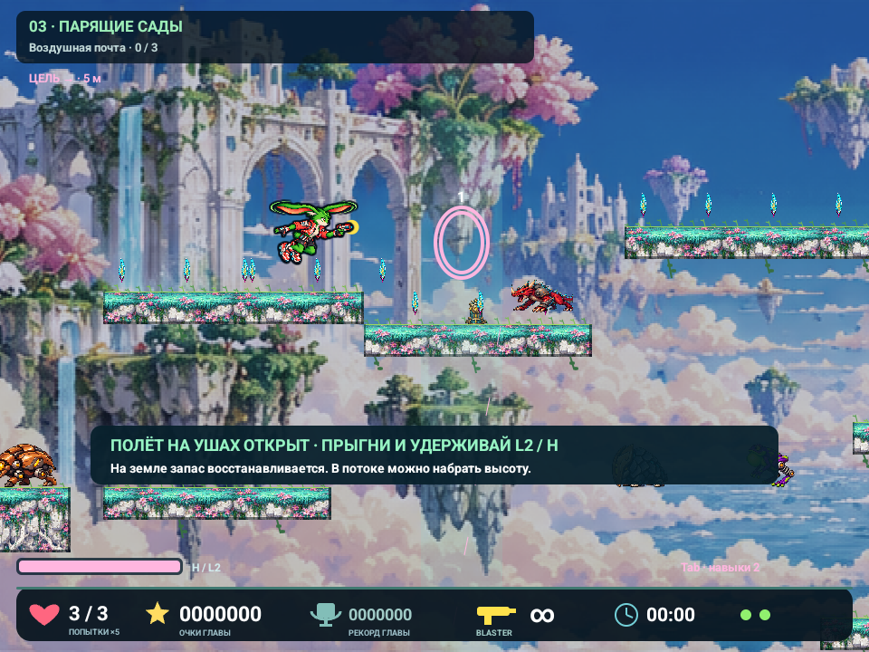

[English](README.md) · [Русский](README.ru.md)



# Neon Hare

**Беги быстрее. Ищи тайные пути. Дай бывшему врагу второй шанс.**

Знакомьтесь: **Stu**, зелёный заяц с бластером и ушами, которые умеют не только слушать. Neon Hare — яркий двухмерный экшен-платформер для Android-смартфонов и портативных консолей: двойные прыжки, секретное оружие, подземные обходы, воздушные сады и злодеи, которым есть что терять.

[**Скачать APK / Releases**](https://github.com/sklevtsov/neonhare/releases) · [Сообщить об ошибке](https://github.com/sklevtsov/neonhare/issues/new/choose) · [План развития](docs/development-plan.md)

> **Игра в разработке.** В кампании 12 доступных прототипов глав; темп, обучение и баланс ещё дорабатываются. Язык игры сейчас — **русский**, английская версия запланирована. Подписанные APK распространяются через Releases. Первый публичный выпуск — ранняя тестовая версия.

## Заяц, сломанный мир и второй шанс

Лесные кроны сменяются водостоками, парящими островами, неоновыми улицами, кристальными пещерами, пустынными руинами и ледяной цитаделью. Собирай энергетические семена, развивай умения Stu и находи спрятанные архивы. Встреться со **Львом Арденом** — сильным противником, чьи решения навредили тем, кого он хотел защитить. Победа над ним ведёт к примирению и открывает полёт на ушах.

- **Движение, которое можно освоить:** высота прыжка зависит от удержания, есть второй прыжок, небольшое прощение схода с края, пружины, воздушные потоки и уши-вертолёт.
- **Пять видов оружия:** бесконечный бластер, скорострельный импульс, дробовик, заморозка и рикошеты. Ищи тайники и вкладывай очки в пять веток умений.
- **Поводы свернуть с дороги:** верхние и нижние маршруты, переходы, треснувшие стены, задания глав, секреты и пасхалки.
- **Прогресс сохраняется:** контрольные точки, выбор открытых глав, очки, лучшее время и рекорды по секретам.
- **Разные способы играть:** кнопки Anbernic, подключённый геймпад или сенсор. Горизонтальная компоновка адаптируется от 4:3 до широких телефонов.
- **Без сети:** в текущей версии нет аккаунтов, рекламы и разрешения на доступ в Интернет.

## Скриншоты

Настоящие снимки экрана эмулятора с подготовленными сценами текущей игры; отладочные подписи скрыты. Баннер сверху — отдельная промо-иллюстрация. Интерфейс и баланс ещё меняются.

| Зелёный разлом | Лев Арден |
|---|---|
|  |  |



[Как получены кадры и изображения](docs/media/README.md)

## Как скачать и установить

1. Открой [Releases](https://github.com/sklevtsov/neonhare/releases) и выбери последний опубликованный выпуск. Пометка **Pre-release** означает тестовую версию.
2. В разделе **Assets** скачай `neon-hare-<версия>.apk`. Архивы **Source code** — это исходники, а не установщик игры.
3. Открой APK на Android и при необходимости разреши установку из используемого браузера или файлового менеджера. Минимальная версия по коду — **Android 6.0**; проверенных устройств пока немного.
4. Следующие официальные версии устанавливай поверх старой, чтобы сохранить прохождение. Для обновления не нужно удалять игру или очищать её данные.

К APK прилагается `SHA256SUMS`. Проверка файла, подписи и настройка выпуска описаны в [инструкции по релизам](docs/releases.md). APK лежат в Releases, а не в Git. Отладочные APK из [Actions](https://github.com/sklevtsov/neonhare/actions/workflows/ci.yml) предназначены разработчикам и ставятся отдельным приложением `com.neonhare.game.debug`.

**Совместимость:** целевые устройства — Anbernic RG406V (960×720) и обычные Samsung/Android в горизонтальном режиме, включая широкие экраны и вырезы. На телефонах есть сенсорное управление. Успешный тест эмулятора не означает проверку всех смартфонов: стабильному кандидату нужен запуск на физических устройствах.

## Управление

| Действие | Anbernic / геймпад | Клавиатура |
|---|---|---|
| Ходить | Крестовина / левый стик | ← → |
| Прыжок / второй прыжок | Вверх, A или B | ↑ / Пробел |
| Стрелять, можно удерживать | X, R1 или R2 | Z |
| Сменить оружие | Y / L1 | X |
| Полёт на ушах | Удерживать L2 в воздухе | Удерживать H в воздухе |
| Переход / спрыгнуть сквозь платформу | Вниз | ↓ / E |
| Меню, сохранение и выбор главы | Start | Esc / M / P / Enter |
| Прокачка | **Select** | Tab |
| Выбрать / купить навык | Крестовина, затем A | 1–5 / ↑↓, затем Enter |

Для второго прыжка отпусти и нажми кнопку ещё раз. Уши открываются автоматически после встречи со Львом во второй главе: **прыгни и удерживай L2 / H**, на земле заряд восстанавливается. На телефоне используй экранные кнопки. Контрольные точки и прогресс сохраняются автоматически; в главном меню также есть явное сохранение с выходом.

## Сборка и разработка

Нативный **Java + Android Canvas/SurfaceView**, симуляция с фиксированным шагом, без стороннего игрового движка. Нужны **JDK 17**, **Python 3.10+**, Android SDK platform **35**, build-tools **36.0.0** и platform-tools. Gradle нужной версии скачивает wrapper из репозитория.

```sh
git clone https://github.com/sklevtsov/neonhare.git
cd neonhare
# Укажи установленный SDK в ANDROID_HOME или в local.properties: sdk.dir=...
./gradlew assembleDebug
```

APK для разработки: `app/build/outputs/apk/debug/app-debug.apk`. Установка на явно выбранный эмулятор:

```sh
adb -s emulator-5554 install -r app/build/outputs/apk/debug/app-debug.apk
adb -s emulator-5554 shell am start -n com.neonhare.game.debug/com.neonhare.game.MainActivity
./scripts/check-game.sh
```

`check-game.sh` работает **только с emulator-5554**. Сначала создай и запусти подходящий Android AVD. Необязательный помощник `scripts/run-emulator.sh` ожидает уже созданный AVD `NeonHare` в локальной `.android-dev/avd`; SDK и эмулятор на чистой машине он не создаёт.

```sh
./scripts/format-java.sh
python3 tools/level_content.py
./gradlew checkJavaFormat lintDebug lintLocal lintRelease
./scripts/check-signing.sh
./scripts/check-level-extension.sh
```

Проверки выполняются на настоящем приложении в эмуляторе: движение, кнопки/сенсор, начало траектории и попадания пуль, боссы, миграции сохранений и подключение новой главы. Debug-сборка получает 99 жизней и цифровые отладочные команды; local/release их отключают. `./scripts/package-apk.sh --local` использует существующий локальный ключ разработчика. Публичный `--release` требует отдельного постоянного ключа.

### Новые главы добавляются рядом

```sh
python3 scripts/new-level.py night-postal-hub --title 'Ночной почтовый узел'
python3 tools/level_content.py --preview-dir build/level-previews
```

Сначала обсуждаются черновик и карта маршрута; затем согласованная глава явно включается в `app/src/main/assets/levels/campaign.json`. У каждой главы свои `level.json` и `design.md`, а стабильные ID защищают сохранения от изменения порядка кампании. Новая механика добавляется через отдельные правила заданий и системы, без ветвлений по номеру главы.

- [Архитектура и контракты сохранений](docs/architecture.md)
- [Проектирование и добавление уровней](docs/adding-levels.md)
- [Правила разработки](CONTRIBUTING.md) · [Инструкции агентам](AGENTS.md)
- [Выпуск APK](docs/releases.md) · [Политика безопасности](SECURITY.md)
- [Кампания и сюжет](docs/campaign.md) · [План развития, включая английскую локализацию](docs/development-plan.md)

Ближайший приоритет — качество глав 1–3. Затем обсудим **«Ночной почтовый узел»**: доставки, смену маршрутов и перехватчиков. Английская локализация — отдельный запланированный этап. Эти будущие изменения ещё не следует считать готовыми.

## Лицензия и изображения

Код проекта распространяется под [MIT](LICENSE), кроме сторонних компонентов с собственными условиями. **Игровая графика, иконки, скриншоты и промо-изображения в MIT не входят**; разрешение на их переиспользование не предоставляется. См. [условия для изображений](ASSETS-LICENSE.md) и [сторонние компоненты](THIRD_PARTY_NOTICES.md).
