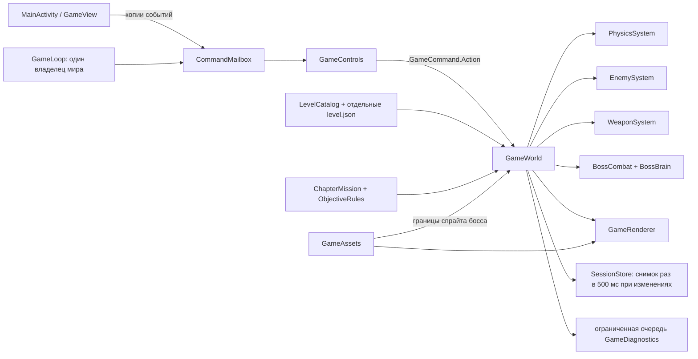

# Архитектура после рефакторинга 0.4

## Границы компонентов



`GameWorld` координирует состояние; столкновения, враги, оружие и оркестрация боя вынесены в отдельные системы.

`GameView` — адаптер Android Surface и событий, а не генератор уровней. `GameLoop` управляет фиксированным шагом симуляции, кадрами и остановкой. Мир изменяет только его владелец. UI кладёт копии событий в FIFO-очередь; её переполнение явно сбрасывает удерживаемые кнопки, чтобы не оставлять их зажатыми. Семантические команды — enum с отдельными параметрами, а не число `100 + chapter`.

Симуляция и отрисовка выполняются последовательно одним потоком. Renderer читает мир; собственный RNG визуальных эффектов больше не меняет случайность стрельбы в зависимости от количества кадров. Android-ресурсы загружаются в `GameAssets`. Рамки попаданий босса продолжают учитывать альфа-границы существующих изображений.

Остановка не запускает вторую симуляцию, пока прежняя не завершилась. При позднем завершении старого потока повторный запуск учитывает актуальные resume/surface-флаги. Прерывание сна очищается перед финальной записью сохранения; запись и освобождение владельца разделены. Двенадцать последовательных циклов resume/pause проверяются автоматически.

## Уровни

Контент лежит в `app/src/main/assets/levels/<stable-id>/`:

- `design.md` — обсуждаемая идея, маршрут и критерии приёмки;
- `level.json` — геометрия, объекты, задачи, условия, визуальная тема и контрольные точки;
- `preview.svg` — необязательная карта для обсуждения.

`campaign.json` перечисляет порядок глав. `Campaign` загружает метаданные из каталога; старых Java-генераторов карт и выбора геометрии через номера глав больше нет. Стиль `open/tower/...` отвечает за представление, а не выбирает готовый шаблон комнаты.

У обычной новой главы можно менять ширину/высоту, старт, выход и шлюз, платформы, врагов, предметы, переходы, потоки и существующие правила целей без изменения Java. Добавление принципиально нового поведения требует реализации правила и регистрации типа в движке; не требуется переписывать уже готовые главы.

Встроенные боссы пока имеют общую арену в правой части карты и требуют ширины не менее 168 тайлов. Изменение самой модели арены или новый тип босса — новая возможность движка, а не скрытая опция контентного файла. Размер тайла — 36 пикселей; размеры персонажей и физические единицы общие для игры.

## Сохранения

Формат 2 хранит стабильные ID глав, предметов, целей и checkpoint. Прохождения, пасхалки, модули и открытые главы — множества ID; ограничение в 32 главы устранено. Рекорды также привязаны к ID, а не к позиции в списке. Проверяется кампания на 40 глав и перестановка её порядка. Отдельно полный прогон проходит с временной тринадцатой главой, добавленной штатным скриптом без изменений Java.

`LegacySaveIds` — замороженное соответствие старых индексов версии 0.3. Его нельзя менять при редактировании новой кампании. Перед первой записью формата 2 сохраняется исходный снимок в `noBackupFilesDir/*-before-v2.json`. Запись резервной копии завершается атомарным переименованием. Более новый неизвестный формат не перезаписывается.

`revision` относится к состоянию конкретного захода. Если геометрия главы изменена и revision повышена, старый checkpoint и частично выполненные задачи сбрасываются до начала этой главы; навыки, открытия и рекорды остаются. Смена порядка глав не требует повышения revision.

Обычные изменения помечают сохранение грязным; запись объединяется с интервалом 500 мс. Pause и «Сохранить и выйти» принудительно фиксируют снимок. Восстанавливаются здоровье Stu, здоровье босса и остаток попыток, что закрывает бесплатное лечение через перезапуск. Логи пишутся отдельным ограниченным worker; только запись самого необработанного исключения синхронна.

Backup-политика включает основной игровой профиль и исключает диагностические/тестовые файлы. Незашифрованные локальные очки не считаются секретом; сетевых аккаунтов и платежей в игре нет.

## Проверки

- `CatalogChecks` сверяет геометрию, позиции объектов и checkpoint всех 12 глав с эталоном до рефакторинга.
- `CustomLevelChecks` загружает отдельную карту 96×32 с собственными стартом, полом и шлюзом и проверяет настоящую физику на ней.
- `SaveMigrationChecks` проверяет старые сохранения, приоритет ID, более 32 глав, перестановку каталога, ошибочные значения, backup и восстановление боя.
- `ConcurrencyChecks` проверяет FIFO, явное переполнение, параллельных производителей, запрет чужого владельца и циклы lifecycle.
- `GameChecks` сохраняет игровые регрессии движения, прыжков, боёв, предметов, меню и разных миссий.

Число проверок не равно числу независимых сценариев: часть выполняется по строкам и объектам эталонов. Полные ручные прохождения и оценка удовольствия/баланса остаются отдельной работой.

## Сборка и стиль

```sh
./scripts/format-java.sh
./scripts/format-java.sh --check
python3 tools/level_content.py --preview-dir build/level-previews
./scripts/check-game.sh
./scripts/check-signing.sh
./scripts/package-apk.sh --local
```

Java форматируется закреплённым google-java-format 1.22.0 в стиле AOSP с четырьмя пробелами и явными блоками. Formatter не входит в APK. Gradle wrapper и зависимости инструментов закреплены хешами. Любая Android-сборка запускает контентный валидатор.

`--local` — явно локальная APK, совместимая с прежним сертификатом на устройствах. `--release` требует отдельные `NEONHARE_RELEASE_KEYSTORE`, `NEONHARE_RELEASE_ALIAS`, `NEONHARE_STORE_PASSWORD`, `NEONHARE_KEY_PASSWORD`, `NEONHARE_RELEASE_CERT_SHA256` и отказывается подписывать публичный выпуск debug-ключом. Пароли передаются signer через окружение. Новый ключ автоматически не создаётся: для публичного выпуска нужно отдельно спланировать миграцию подписи установленных версий.
