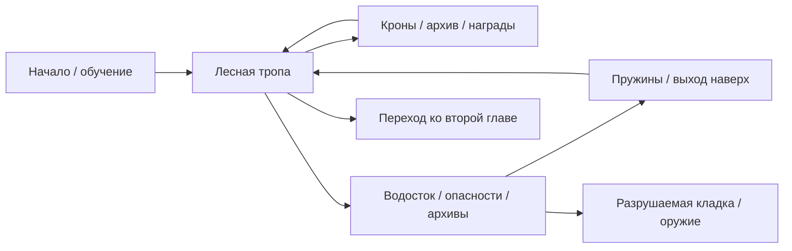
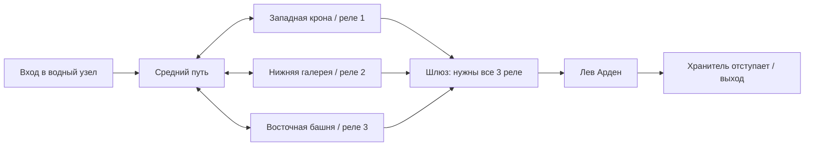

# Neon Hare — рабочая версия сюжета и уровней

Актуальные задания всех 12 глав, меню, рекорды и сохранения описаны в [версии 0.3.0](release-0.3.0.md). После водостока главы используют отдельные механики, а не общий набор реле.

Первоначальная основа сюжета. Текущая версия расширена до 12 глав: см. [кампанию и прокачку](campaign.md). Лев теперь безусловно становится союзником; это обязательное правило истории.

## Что лежит в папке оригинала

В `Jazz_Jackrabbit 2/` фактически находится DOS-версия **Jazz Jackrabbit 1994 года**.
Это подтверждают заголовок `MANUAL.DOC` с названием и годом, `JAZZ.EXE`,
файлы `LEVEL0.000` / `LEVEL1.000` и семейство `BLOCKS.*`. Заголовок первого уровня
содержит имя Diamondus. Исходников C/C++ и карт JJ2 в формате `.j2l` в папке нет.
Бинарные карты не импортировались и не декодировались: это исследование структуры
поставки и руководств, а не точная реконструкция геометрии оригинала.

Локальное руководство описывает контрольные точки и исследование. В
[оригинальном руководстве JJ2](https://files.bachsau.com/Manuals/Jazz2.pdf),
английские разделы Scoring и Coins, описаны секреты, разрушаемые блоки, монеты и
Coin Warp. [Документация редактора JJ2+](https://docs.jj2.plus/levelediting.php)
различает обычные твёрдые тайлы, односторонние полы и специальные события.
JJ2+ — расширение, его новые возможности не приписываются оригинальной игре.

Для Neon Hare взяты принципы: чередование скорости и исследования, обходные
маршруты на разных высотах, видимые награды как подсказки, разрушаемый проход,
возвращение из нижней ветки, сюжет через окружение. Геометрия и персонажи свои.

Главный герой — зелёный заяц **Stu**.

## Конфликт

Лес умирает, потому что водный узел отбирает воду у живых корней. Stu приходит
с привычным решением: уничтожить насос. Лев Арден охраняет узел — вода нужна
убежищу беженцев, где живут представители разных кланов. Разрушение насоса
спасёт лес ценой людей в убежище.

Лев сам подписал распоряжение об отводе воды и отвечает за последствия. Он
считает, что вправе выбрать, кому выжить, но ненавидит необходимость такого
выбора. Он укрывает раненых врагов и одновременно выполняет приказ Совета,
удерживающего его семью у плотины. Stu тоже несёт ответственность: прежняя
диверсия героя уже оставила квартал без воды. Оба привыкли к силовым решениям.

Синие архивы показывают не только преступления Совета, но и собственные решения
Льва и Stu. Старый чертёж обходных каналов позволяет сохранить лес и убежище.
Второй уровень превращает эту находку в действие: игрок восстанавливает реле.
Лев ещё не доверяет Stu и защищает насос. В бою герой пробивает защиту,
а не убивает хранителя; после поражения Лев замечает восстановленный поток.

## Реализованные главы

### 01 — Зелёный разлом

Сохранено знакомое начало с обучением движению и прыжкам. Карта расширена до
168 × 27 клеток. Теперь есть верхний маршрут по кронам, средняя лесная тропа
и водосток с платформами, опасными корнями, оружием и архивами. Пружины дают
выход наверх, камера сопровождает игрока по вертикали. Растрескавшуюся кладку
можно разбивать выстрелами. Боковые маршруты необязательны для выхода.

### 02 — Сердце водостока

Три реле: западная крона (46-я колонка, 4-й ряд), нижняя галерея (91-я колонка,
19-й ряд) и восточная башня (116-я колонка, 3-й ряд). До их включения шлюз
в 133-й колонке закрыт на всю высоту карты; перелететь его поверх карты нельзя.
Реле можно коснуться или активировать выстрелом. Открытый шлюз ведёт к арене.
Падение не отменяет включённые реле и найденные в текущем прохождении архивы.

### Лев Арден — бой

- 48 единиц здоровья; попадания в видимое тело всегда наносят урон.
- Перед рывком видны подготовка и полоса направления; сам рывок можно перепрыгнуть.
- Следующий тип атаки — две ударные волны по полу; от них спасают прыжки и платформы.
- После атаки урон удваивается; подготовка, прыжок и атака имеют разные позы.
- На половине защиты подготовка короче, рывок быстрее, передышка меньше.
- Выход не завершает главу до капитуляции босса.
- На бой три попытки; здоровье босса между ними не восстанавливается. Реле и архивы сохраняются.

Лев обязательно становится союзником после своего боя и остаётся добрым в финале.
Архивы раскрывают его поступки, но их число не определяет примирение. Он дарит
аэропривод и помогает в следующих главах. Прокачка, главы и найденные секреты
теперь сохраняются между запусками; точка возобновления — начало главы.

## Что развивать дальше

Лев уже стал постоянным союзником. Дальше он может оказаться неуверенным свидетелем: он знает, как
работает система, но скрывает подписи под прежними приказами. Следующая глава
у плотины проверит не обещание союза, а способность героев уступить контроль.
Хорошая тема эпизода — цена спасения: можно ли спасти своих, не назначив чужих
расходным материалом? Stu придётся отвечать за прежние диверсии, а Льву — за
привычку решать за всех.

Для обсуждения: делать ли Совет единой силой или
конфликтующими группами; какие последствия должны менять следующие уровни.

## Отладка

`2` переходит к следующей из 12 глав; `3` открывает арену Льва с уже включёнными реле.
Это только debug-сборка, на Anbernic она автоматически не устанавливается.
`./scripts/check-game.sh` проверяет прежнюю физику, выход пружиной из водостока,
вертикальную камеру, разрушаемый проход, архивы, реле, переход главы и состояния босса.
Автоматические проверки не заменяют полного ручного прохождения обеих карт.
